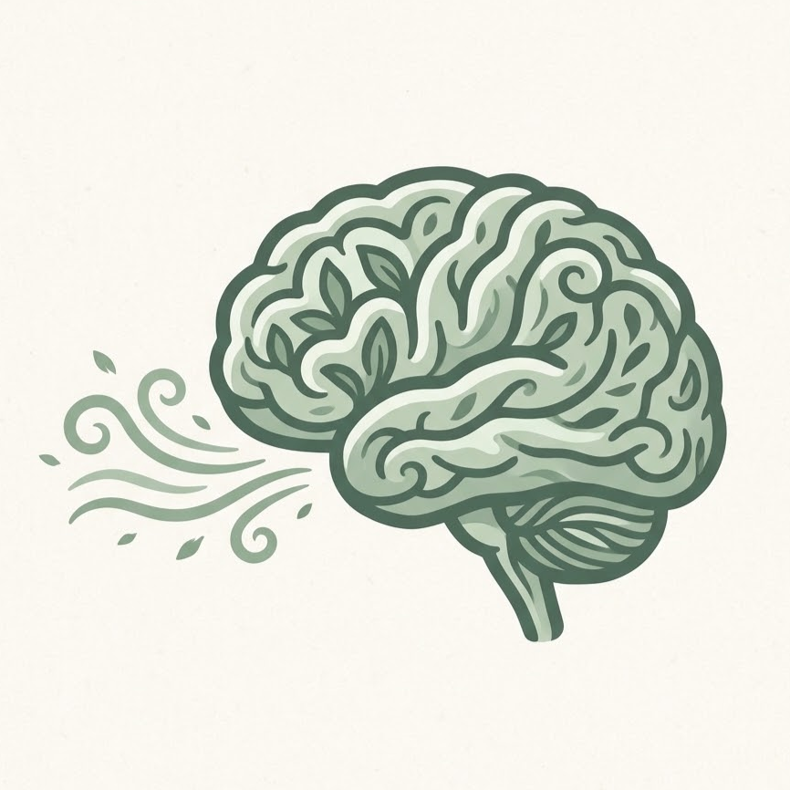

<div align="center">
  
  <h1>🌿 MindfulGate · 清醒门神</h1>
  <p><strong>基于认知神经科学与正念交互的浏览器防沉迷插件🧠</strong></p>
  <p><em>A Neuroscience-Driven Chrome Extension to Break the Dopamine Loop & Doomscrolling.</em></p>

  <p>
    
    
    
    
  </p>
</div>

---

## 💡 为什么做这个产品？ (Background)

在算法与瀑布流统治注意力的时代，“原本只想打开社交媒体查个资料看 5 分钟，回过神来已经刷了 1 小时”成了普遍困境。传统的防沉迷工具往往采用“一刀切”的硬性锁屏，极易激起用户的逆反心理或被肌肉记忆随手点掉。

**MindfulGate（清醒门神）** 换了一种解法——它不与人性对抗，而是利用**脑神经科学**与**交互摩擦力（Cognitive Friction）**，在恰当的节点介入多巴胺回路：
1. **进门前：** 唤醒背外侧前额叶（dlPFC），将“无意识滑动”转化为“有目的检索”，并直达搜索结果页，物理绕开首页推荐流诱惑。
2. **结束前：** 通过渐进式视觉褪色与滚轮阻尼，悄然抽走视觉奖赏与滑动爽感。
3. **超时后：** 用 1:2 的正念深呼吸引导激活副交感神经，配合“禁止粘贴的打字契约”，彻底打断僵尸刷屏状态。

---

## ✨ 核心功能闭环 (Core Features)

### 1. 🎯 意图门神与搜索直达 (Intent Gatekeeper & Direct Search)
* **前额叶唤醒：** 打开目标社交媒体时，首先询问：*“在进入信息流之前，先停一下：你点击的目的是什么？”*
* **屏蔽首页推荐流：** 输入关键词并按回车（`Enter`），插件将**直接跳转至该平台的搜索结果页**，让你连 0.1 秒的首页信息流都不会看到，直奔主题。
* **跨标签页全局同步：** 基于 `chrome.storage` 实现同域名跨 Tab 状态同步。点开任意帖子新标签页，右上角的“书签胶囊”倒计时无缝延续，绝不重置。

### 2. 🌫️ 多巴胺褪色器与物理阻尼 (Dopamine De-saturator & Scroll Friction)
* **渐进式黑白化：** 在倒计时剩余最后 60 秒（15秒模式下为最后 10 秒）时，网页饱和度随剩余时间从 `grayscale(0%)` 线性衰减至 `100%`，让花哨的封面图逐渐变成毫无吸引力的黑白报纸。
* **25% 滚轮物理阻尼：** 进入最后倒计时阶段，自动接管页面 `wheel` 事件，将滚动速度降为原本的 **25%**，用轻微的卡顿迟滞感消解无限下拉的顺滑爽感。

### 3. 🧘 生理降温：24秒正念呼吸引导 (1:2 Mindful Breathing Ritual)
* 当设定时间耗尽遮罩重新合拢。
* 屏幕中央浮现动态呼吸圆点，引导用户完成两组 **“鼻吸气 4 秒（圆点内聚缩小）— 口呼气 8 秒（圆点舒展放大）”** 的正念呼吸练习，利用生理节律降低杏仁核唤醒度与焦躁感。

### 4. ✍️ 认知摩擦力契约 (Cognitive Friction Pledge)
* 呼吸结束后，默认高亮选项为 **“否（确认离开网页）”**，顺水推舟帮用户及时抽身。
* 若确因正事未办完需要延长（3 / 5 / 10 分钟），下方会弹出防作弊输入框（已禁用 `Ctrl+V`、右键粘贴与拖拽），用户必须手动一字不差敲出：**“我确认目前仍在处理写下的目的，并非无意识刷算法流”**，方可恢复网页色彩与顺滑度。

---

## 🧠 设计背后的神经科学支点 (Neuroscience & UX Principles)

| 设计维度 | 落地细节 | 心理学 / 脑科学理论依据 |
| :--- | :--- | :--- |
| **色彩心理学** | 羊皮纸白 + 鼠尾草绿 + 亚麻毛玻璃 | **注意力恢复理论 (ART)**：低饱和度自然色系可降低皮质醇水平，抑制交感神经冲动。 |
| **字体与排版** | 标题采用人文衬线体，搭配高留白卡片 | **双系统理论（《思考，快与慢》）**：模拟纸质书的“慢阅读”质感，唤醒系统 2（理性脑）。 |
| **动作指令文案** | `我想主动寻找...`（第一人称 + 主动动词） | **执行意图 (Implementation Intentions)**：自我指涉词汇能显著激活内侧前额叶皮层 (mPFC)。 |
| **视觉权重助推** | 主按钮高对比度直达搜索，“随便看看”弱化为底部极小文字链 | **助推理论 (Nudge Theory)**：在不剥夺自由选择权的前提下，增加无目的浏览的心理阻力。 |

---

## 🌐 支持的平台 (Supported Platforms)

目前已内置以下 **9 大主流内容与社交平台** 的拦截与搜索直达路由：
* 国内平台：**小红书 (RedNote)**、**抖音 (Douyin)**、**哔哩哔哩 (Bilibili)**、**快手 (Kuai)**
* 海外平台：**YouTube**、**X (Twitter)**、**Instagram**、**TikTok**、**Threads**

---

## 🚀 零基础安装指南 (Installation)

本项目采用原生 Manifest V3 + Shadow DOM 开发，**零第三方依赖、无需任何打包构建工具**，下载即可直接运行：

1. 点击本页面右上角的绿色按钮 **`<> Code`** -> 选择 **`Download ZIP`**，下载后解压到你电脑的任意位置（请勿删除解压后的文件夹）。
2. 打开 Chrome 或 Edge 浏览器，在顶部地址栏输入：
   ```text
   chrome://extensions/
